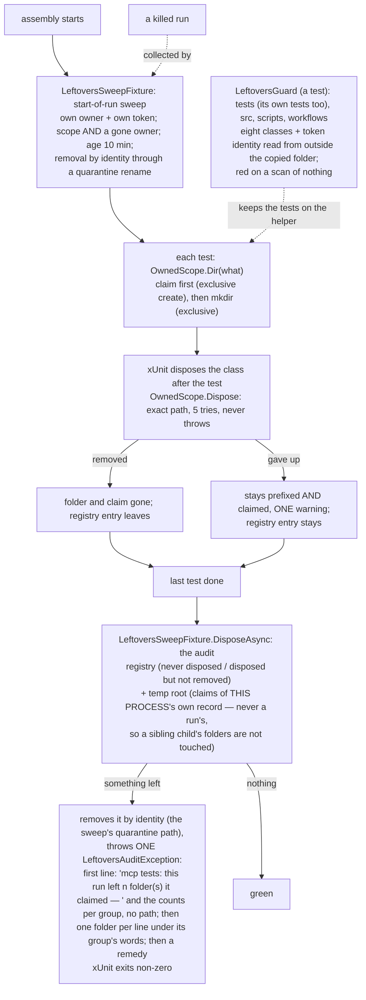

# Module — tests

> `tests/Mcp.Tests`, and inside it `tests/Mcp.Tests/Leftovers/`. The system as it is, 2026-10-31.

## Purpose

Prove the server's behaviour (dispatch, both presentations, the workspace sandbox, telemetry, logging, the
layering boundary) and prove that **the proof leaves nothing behind**: every scratch folder a test makes is
named `testsToDelete-<owner>-mcp-<what>-<id>`, claimed before it exists, removed by the test that made it,
collected by the same user's next run if a run was killed, and kept so by a guard. The rule is the shared
`common/test-leftovers.md` (read it as the contract); this module is its C# implementation for this repository.

## Where the harness is, and how it runs

- **`tests/Mcp.Tests`** — xUnit v3 on Microsoft Testing Platform, one executable. **Never `dotnet test`** (there is no VSTest
  host; it aborts). Locally, lowered and capped:
  `node .claude/rules/shared/tools/low-priority.mjs dotnet build dew_flow_mcp.slnx -c Debug -m:4`, then
  `node .claude/rules/shared/tools/low-priority.mjs ./tests/Mcp.Tests/bin/Debug/net10.0/Mcp.Tests` (add
  `--filter-namespace "Mcp.Tests.Leftovers"`, `--filter-class`, `--filter-method`). CI runs the Release build of the same
  executable on Linux (`build-test`) and on Windows (`build-test-windows`, the whole executable).
- **`tests/Mcp.Tests/Leftovers/`** — the helper and everything that keeps it honest (below).
- **`http/`** — the httpyac contract suite against a running host, run by the `contract` job (not by this executable).
- **The janitor**, by hand on a machine that stopped running these tests:
  `bash .claude/rules/shared/tools/janitor.sh --token mcp --dry-run` (Git for Windows' bash on Windows, never WSL's, which
  sees neither the Windows temp root nor Windows pids; forced dry-run there). `would run:` lines on stdout; exit 0 clean,
  3 something skipped, 1 a failed listing, 2 usage. `JANITOR_MIN_AGE_MINUTES` sets the age window.

## The leftovers flow



## Core entities

| Type (`Mcp.Tests.Leftovers`) | Role |
|---|---|
| `OwnedToken` | THIS repository's token (`mcp`) and its row of the rule's `## Tokens` table — the one file a copy rewrites |
| `Owned`, `OwnerToken` | the name grammar, `NameFor`, the owner token (`u<uid>`, or `w<digits>` on Windows), `TempRoot()` — the one place a test learns the temp root |
| `Owner`, `Liveness`, `Scope`, `Native` | the record `<owner>:<host>@<os>:<pid>[:<start>[:<ns>]]`, the three-valued liveness (`gone` only when no process has the pid), the kernel-owner read, the claim read through one handle checked as a regular file and the file judged (a FIFO or another file swapped in after the check is unreadable, never a hang), and every OS call through one P/Invoke file |
| `OwnedDir`, `OwnedScope`, `Removal` | the helper tests use: claim → register → create; exact teardown that never throws; the process-wide registry of folders not yet reclaimed |
| `LeftoversSweep`, `LeftoversSweepFixture` | the start-of-run sweep as an assembly fixture, and (in `DisposeAsync`) the end-of-run audit |
| `LeftoversAudit`, `LeftoversAuditException` | `Unreclaimed()`, `ClaimedBy()`, `Verdict()`, `Run()`; the failure is typed (`NeverDisposed`, `DisposedNotRemoved`, `ClaimedInTempRoot`) |
| `LeftoversGuard` and `GuardFiles`, `GuardText`, `GuardLiterals`, `GuardDocker`, `GuardExemptions`, `GuardScripts`, `GuardTokens` | `Scan(root)`, `TokenFindings`, `RegisteredTokenFindings`, `ConstantFindings`; C# lines are also read the way the compiler reads their literals (`GuardLiterals`); scripts judged by the mounted `sweeper-scan.mjs` through `node` (its module and the script paths travel as arguments); every method of complexity 4 or less (CA1502 fails the build) |
| `LeftoversSelfTest` | leaks on purpose when `MCP_LEFTOVERS_SELFTEST` is set (`1`, `failed-dispose`); skips otherwise |

A test class that needs a scratch folder is `IDisposable` over an `OwnedScope`:

```csharp
public sealed class ExampleTests : IDisposable
{
    private readonly OwnedScope _owned = new();
    public void Dispose() => _owned.Dispose();

    [Fact]
    public void Writes_somewhere() { var dir = _owned.Dir("example"); /* … */ }
}
```

## Flows — each `covered` or `not covered`

| Flow | Status | Where |
|---|---|---|
| Tool dispatch, refusal vs failure, caller identity | covered | `ToolCatalogTests`, `CallerIdentityTests`, `ProtocolCallerIdentityTests`, `ProtocolErrorFlagTests` |
| The two presentations advertise one surface | covered | `SurfaceParityTests`, `BridgeErrorParityTests`, `ToolSurfaceTests`, `SurfaceFingerprintTests` |
| The workspace sandbox: `..`, absolute paths, links, caps, windows | covered | `WorkspaceToolTests` |
| Telemetry spool and the `telemetry/v0` wire shape | covered | `SpoolUsageSinkTests`, `SpoolFixtureTests`, `TelemetryWireShapeTests`, `TelemetryCorrelationTests`, `PayloadBudgetTests` |
| Health, logging, retention | covered | `HealthTests`, `DailyRunFileSinkTests`, `LogRetentionTests`, `AnsiConsoleSinkTests` |
| The layering boundary and the local CPU budget | covered | `ArchitectureTests`, `LocalCpuBudgetTests` |
| The management surface over the wire, against a running host | covered, by the `contract` job | `http/` |
| The runner's facts (who owns a file a test makes) | covered | `RunnerFactsTests` |
| The helper: names, claim-first, exclusive create, never-throw teardown, the registry | covered | `OwnedTests`, `OwnerTests`, `LivenessTests`, `LivenessStateTests`, `ScopeTests`, `NativeTests` |
| The start-of-run sweep | covered | `LeftoversSweepTests` |
| The end-of-run audit: it takes only this process's own claims (a live sibling's folders survive), removes by identity, and fails with a typed exception | covered | `LeftoversAuditTests`, and the CI step "The audit fails a run that leaves a claimed folder" over `LeftoversSelfTest` (Linux, and in PowerShell on the Windows job) |
| The guard, its eight classes, the bare prefix word in any spelling (a literal, a glob, a class, a pattern, a bare word; and, read as the compiler reads it, an escape, pieces joined by `+` / `string.Concat` / interpolation holes, a one-character regex class, a `/tmp` or `/var/tmp` literal, a temp variable named in pieces), `Owned.TempRoot` outside the helper, a scan of nothing, its own test file scanned clean | covered | `LeftoversGuardTests`, `LeftoversRepositoryGuardTests` |
| The token identity (the token file's pair against the solution file's name, kept outside the copied folder) | covered | `RepositoryIdentityTests`, `LeftoversGuardTests` |
| The janitor reading this helper's claim (Linux) | covered | `LeftoversJanitorTests`, Linux job |
| The janitor reading this helper's claim (Windows) | **not covered** by CI — by hand: forced dry-run under Git for Windows' bash; a WSL bash reads every Windows claim as foreign | — |
| An elevated Windows run (new files owned by `BUILTIN\Administrators`, so the kernel-owner key fails closed and keeps them) | **not covered** by CI beyond the ownership fixtures — by hand on the owner's machine | `WindowsOwnership`, `ScopeTests` |
| A real MCP client over stdio against the built host | **not covered** — no test starts the built host with `--stdio` and speaks to it; the protocol presentation is tested in process | — |

## What it does not prove

- A SIGKILL of the real executable: the kill is built by hand in the sweep tests (a dead pid in a claim).
- macOS: no CI leg and no machine; the helper refuses to run there with a clear message.
- The container carve-out of rule §5: this repository starts no container, so the guard does not recognise it — a
  `docker run` without `--rm` is a finding.
- The guard of C# is a SPELLING check. It decodes escapes (`\uXXXX`, `\UXXXXXXXX`, `\x…`), joins the literals that are operands of `+`
  or of `string.Concat` and the interpolation holes that hold only a literal, reads a one-character regex class (`[T]`) as its character,
  and refuses any literal that holds a piece of the prefix word (five characters or more, case-insensitive, crossing the join of the two
  halves: `testsTo`, `sToDel`, `oDelete`; `tests` and `delete` alone are words) as well as a `/tmp` or `/var/tmp` literal. It reads one line
  at a time. A name that a source generator, an embedded resource, a char array, a file read at run time or a value computed across lines
  assembles is still invisible to it, and so is a prefix spelled in pieces in the files of `LeftoversGuard.FoldingAllowances` (the helper
  `Owned.cs`, the guard, and the two files that build its fixtures — a test pins the list at four).
- The shipped tracer's own limits over scripts (the header of `tools/lib/prefix-bindings.mjs` in the mount): a glob built by
  concatenation, a name from another file, the environment or an argument. The guard reads text: a temp path built by
  reflection or in a generated file is invisible to it.
- The audit runs only when the executable reaches the assembly fixture's `DisposeAsync`. It looks for this process's own record: a
  run that hands `TESTSTODELETE_RUN` down has its children's folders swept by the next run's sweep, not by a sibling's audit.
- The janitor on Windows (forced dry-run, by hand only).

## External dependencies

The mounted conventions (`.claude/rules/shared`, a git submodule — **fetched by every CI job that runs these tests**; a
missing mount FAILS the tests that read it, it is not a clean setup): the rule text and its `## Tokens` table, the owner
vectors (`tools/fixtures/owner-vectors.json`), `tools/lib/sweeper-scan.mjs` (the guard's script half, run through `node`),
and `tools/janitor.sh`. `node` is on every runner and developer machine (`low-priority.mjs` needs it too).

## When it runs

Every pull request (`build-test`, `build-test-windows`); the janitor by hand on a machine that stopped running these tests.
