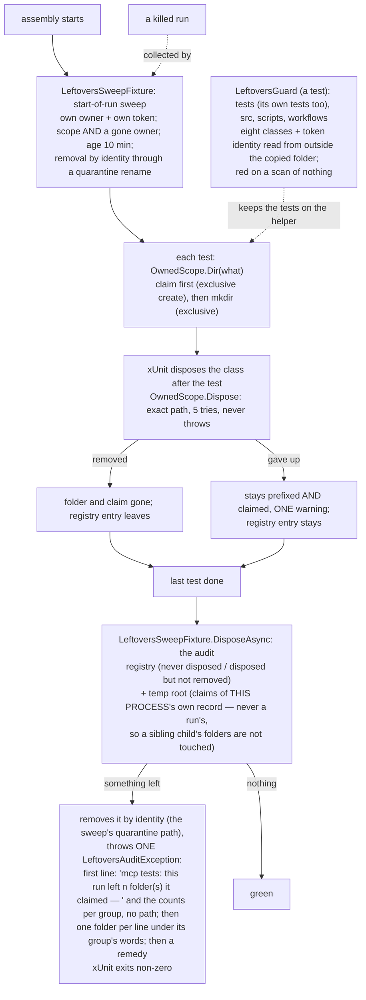

# Module — tests

> `tests/Mcp.Tests`, and inside it `tests/Mcp.Tests/Leftovers/`. The system as it is, 2026-10-31; macOS (Darwin) added 2026-11-01.

## Purpose

Prove the server's behaviour (dispatch, both presentations, the workspace sandbox, telemetry, logging, the
layering boundary) and prove that **the proof leaves nothing behind**: every scratch folder a test makes is
named `testsToDelete-<owner>-mcp-<what>-<id>`, claimed before it exists, removed by the test that made it,
collected by the same user's next run if a run was killed, and kept so by a guard. The rule is the shared
`common/test-leftovers.md` (read it as the contract); this module is its C# implementation for this repository.

## Where the harness is, and how it runs

- **`tests/Mcp.Tests`** — xUnit v3 on Microsoft Testing Platform, one executable. **Never `dotnet test`** (there is no VSTest
  host; it aborts). Locally, lowered and capped:
  `node .agents/conventions/tools/low-priority.mjs dotnet build dew_flow_mcp.slnx -c Debug -m:4`, then
  `node .agents/conventions/tools/low-priority.mjs ./tests/Mcp.Tests/bin/Debug/net10.0/Mcp.Tests` (add
  `--filter-namespace "Mcp.Tests.Leftovers"`, `--filter-class`, `--filter-method`). CI runs the Release build of the same
  executable on Linux (`build-test`), on Windows (`build-test-windows`, the whole executable) and on macOS (`build-test-macos`, `macos-latest`, Arm64: the layout self-test, the
  `Mcp.Tests.Leftovers` namespace, then the whole executable, bare — no low-priority wrapper on CI).
- **`tests/Mcp.Tests/Leftovers/`** — the helper and everything that keeps it honest (below).
- **`http/`** — the httpyac contract suite against a running host, run by the `contract` job (not by this executable).
- **The janitor**, by hand on a machine that stopped running these tests:
  `bash .agents/conventions/tools/janitor.sh --token mcp --dry-run` (Git for Windows' bash on Windows, never WSL's, which
  sees neither the Windows temp root nor Windows pids; forced dry-run there). `would run:` lines on stdout; exit 0 clean,
  3 something skipped, 1 a failed listing, 2 usage. `JANITOR_MIN_AGE_MINUTES` sets the age window.

## The leftovers flow



## Core entities

| Type (`Mcp.Tests.Leftovers`) | Role |
|---|---|
| `OwnedToken` | THIS repository's token (`mcp`) and its row of the rule's `## Tokens` table — the one file a copy rewrites |
| `Owned`, `OwnerToken` | the name grammar, `NameFor`, the owner token (`u<uid>`, or `w<digits>` on Windows), `TempRoot()` — the one place a test learns the temp root |
| `Owner`, `Liveness`, `Scope`, `Native` | the record `<owner>:<host>@<os>:<pid>[:<start>[:<ns>]]` (`linux`, `macos` or `windows`; start and namespace on Linux only), the three-valued liveness (`gone` only when no process has the pid), the kernel-owner read (the entry's uid against `getuid` on Linux and macOS alike), the claim read through one handle checked as a regular file and the file judged (a FIFO or another file swapped in after the check is unreadable, never a hang), and every OS call through the P/Invoke files: `Native.cs` (Linux libc, Windows kernel32 and advapi32) and `NativeDarwin.cs` (macOS libSystem by its full path: `lstat` / `fstat` at Darwin's 144-byte layout, `renamex_np` for the exclusive rename with no fallback, `kill`) |
| `Errno`, `ErrnoTable` | one errno table per system (Darwin's ENOTEMPTY 66, ENOTSUP 45, ENOSYS 78 are never the Linux numbers) |
| `DarwinLayout`, `DarwinLayoutTests`, `DarwinNativeTests`, `DarwinFifoChild`, `NativeDarwinTests` | macOS only, but for the last: the layout self-test of Darwin's `struct stat` that every sweep, audit, native and scope test requires first; `renamex_np` onto a taken name; the FIFO read in a child process that is bounded, tree-killed and reaped; the kill probe. `NativeDarwinTests` and `ErrnoTests` are pure and run everywhere |
| `OwnedDir`, `OwnedScope`, `Removal` | the helper tests use: claim → register → create; exact teardown that never throws; the process-wide registry of folders not yet reclaimed |
| `LeftoversSweep`, `LeftoversSweepFixture` | the start-of-run sweep as an assembly fixture, and (in `DisposeAsync`) the end-of-run audit |
| `LeftoversAudit`, `LeftoversAuditException` | `Unreclaimed()`, `ClaimedBy()`, `Verdict()`, `Run()`; the failure is typed (`NeverDisposed`, `DisposedNotRemoved`, `ClaimedInTempRoot`); a temp root that exists but cannot be reached (a parent this process cannot traverse) is read as such — `lstat`, never `Directory.Exists` — and is a `LeftoversAuditException` naming the root and the error, not "nothing claimed" |
| `LeftoversGuard` and `GuardFiles`, `GuardText`, `GuardLiterals`, `GuardDocker`, `GuardExemptions`, `GuardScripts`, `GuardTokens` | The exemption grammar is in the section below (*The exemption marker*). `Scan(root)`, `TokenFindings`, `RegisteredTokenFindings`, `ConstantFindings`; C# lines are also read the way the compiler reads their literals (`GuardLiterals`); scripts judged by the mounted `sweeper-scan.mjs` through `node` (its module and the script paths travel as arguments); every method of complexity 4 or less (CA1502 fails the build) |
| `LeftoversSelfTest` | leaks on purpose when `MCP_LEFTOVERS_SELFTEST` is set (`1`, `failed-dispose`); skips otherwise |

A test class that needs a scratch folder is `IDisposable` over an `OwnedScope`:

```csharp
public sealed class ExampleTests : IDisposable
{
    private readonly OwnedScope _owned = new();
    public void Dispose() => _owned.Dispose();

    [Fact]
    public void Writes_somewhere() { var dir = _owned.Dir("example"); /* … */ }
}
```

## Flows — each `covered` or `not covered`

| Flow | Status | Where |
|---|---|---|
| Tool dispatch, refusal vs failure, caller identity | covered | `ToolCatalogTests`, `CallerIdentityTests`, `ProtocolCallerIdentityTests`, `ProtocolErrorFlagTests` |
| The two presentations advertise one surface | covered | `SurfaceParityTests`, `BridgeErrorParityTests`, `ToolSurfaceTests`, `SurfaceFingerprintTests` |
| The workspace sandbox: `..`, absolute paths, links, caps, windows | covered | `WorkspaceToolTests` |
| Telemetry spool and the `telemetry/v0` wire shape | covered | `SpoolUsageSinkTests`, `SpoolFixtureTests`, `TelemetryWireShapeTests`, `TelemetryCorrelationTests`, `PayloadBudgetTests` |
| Health, logging, retention | covered | `HealthTests`, `DailyRunFileSinkTests`, `LogRetentionTests`, `AnsiConsoleSinkTests` |
| The layering boundary and the local CPU budget | covered | `ArchitectureTests`, `LocalCpuBudgetTests` |
| The management surface over the wire, against a running host | covered, by the `contract` job | `http/` |
| The runner's facts (who owns a file a test makes) | covered | `RunnerFactsTests` |
| The helper: names, claim-first, exclusive create, never-throw teardown, the registry | covered | `OwnedTests`, `OwnerTests`, `LivenessTests`, `LivenessStateTests`, `ScopeTests`, `NativeTests` |
| The start-of-run sweep | covered | `LeftoversSweepTests` |
| The end-of-run audit: it takes only this process's own claims (a live sibling's folders survive), removes by identity, and fails with a typed exception | covered | `LeftoversAuditTests`, and the CI step "The audit fails a run that leaves a claimed folder" over `LeftoversSelfTest` (Linux, and in PowerShell on the Windows job) |
| The guard, its eight classes, the bare prefix word in any spelling (a literal, a glob, a class, a pattern, a bare word; and, read as the compiler reads it, an escape, pieces joined by `+` / `string.Concat` / interpolation holes, a one-character regex class, a `/tmp` or `/var/tmp` literal, a temp variable named in pieces), `Owned.TempRoot` outside the helper, a scan of nothing, its own test file scanned clean | covered | `LeftoversGuardTests`, `LeftoversRepositoryGuardTests` |
| The exemption marker: the classes it exempts, the `container-scoped` declaration (rule §6 (b)) read case for case as the Node guard does after F41, a refused marker as one `exemption` finding that says why | covered | `LeftoversGuardTests` (the `F42 P1…P7`, `N1…N19` rows of `BreakIt`, and the three tests after it) |
| The two guards agree: the marker and shared-store scenarios are ONE table (`GuardScenarios`), read by the per-row C# tests and fed to the MOUNTED Node guard (`scanText`, through `node`, rows on standard input) — line, class and text must be equal row by row. While the mounted release predates F41 (no `DECLARATION_KINDS` export) the marker rows are skipped with that reason and the unmarked rows still run; after the rules pin reaches the F41 release the skip ends by itself. Rows that differ on purpose carry their reason (`CSharpOnly`: the `.cs` bare-word `owner-blind`, the `docker-run` wording without the carve-out) | covered (marker half skipped until the pin) | `LeftoversGuardDifferentialTests`, `GuardScenarios` |
| The token identity (the token file's pair against the solution file's name, kept outside the copied folder) | covered | `RepositoryIdentityTests`, `LeftoversGuardTests` |
| The janitor reading this helper's claim (Linux) | covered | `LeftoversJanitorTests`, Linux job |
| The helper on macOS: the identity read at Darwin's layout (self-test with `stat(1)` as a second witness), the exclusive create, `renamex_np` onto a taken name, the verified claim read on a FIFO swapped in, the kill probe, the sweep, the audit | covered, by the `build-test-macos` job — **Arm64 only**. X64 / Rosetta (`lstat$INODE64`) is **not covered** anywhere; a volume without `RENAME_EXCL` is covered only as an outcome function (its fail-closed rule), never on a real volume | `DarwinLayoutTests`, `DarwinNativeTests`, `NativeDarwinTests`, `LeftoversSweepTests` |
| The janitor reading this helper's claim (macOS) | **not covered** — its test skips off Linux; `janitor.sh` was never measured on bash 3.2 and BSD tools here | — |
| The janitor reading this helper's claim (Windows) | **not covered** by CI — by hand: forced dry-run under Git for Windows' bash; a WSL bash reads every Windows claim as foreign | — |
| An elevated Windows run (new files owned by `BUILTIN\Administrators`, so the kernel-owner key fails closed and keeps them) | **not covered** by CI beyond the ownership fixtures — by hand on the owner's machine | `WindowsOwnership`, `ScopeTests` |
| A real MCP client over stdio against the built host | **not covered** — no test starts the built host with `--stdio` and speaks to it; the protocol presentation is tested in process | — |

## The exemption marker

A comment `<prefix>-exempt: <kind> — <reason>` on the line of a finding or the line above it (rule §7). The prefix word is written `testsToDelete`.
`GuardExemptions` reads it; `LeftoversGuard` asks it.

- **A class kind** — `raw-temp`, `raw-worktree`, `docker-run`, `docker-name`, `legacy-name`, `shared-store` — clears a finding of that class on
  its line and the next. The reason is at least ten characters and three words and not a placeholder (`needed`, `see above`, `todo`, …);
  `shared-store` also carries `lock:`. `ryuk-off` and `owner-blind` accept none.
- **`container-scoped`** (rule §6 (b)) is a declaration, not a class: `container-scoped — <what> lives and dies with <fixture or job>` (or
  `live and die with`, any case). Valid when the general reason rule holds AND an owner follows `with`: an optional article (`the`, `a`,
  `an`, `its`, `this`, `that`), then a word of at least two characters that is not itself an article — "… lives and dies with the" names no
  owner and is one `exemption` finding that says so. The owner is read the same way in C# and in Node: whitespace is the explicit class `[\f\n\r\t\v\x85\p{Z}]`; a word edge is a lookaround over `[\p{L}\p{Mn}\p{Nd}\p{Pc}\u200C\u200D]` (so `xlives and dies with …` and a joiner before the spelling do not start it); the spelling and the articles are explicit upper/lower letter pairs, never a case-insensitive option (JavaScript's fold reads `ſ` as `s`, .NET's does not); an article followed by punctuation (`a. foo`, `the-fixture`) is no article-then-owner. A valid marker with nothing beside it is clean; the guard never reports a marker for
  exempting nothing. It clears ONE class, `shared-store`, on its line and the next, and only the container's own teardown there:
  `DROP DATABASE`, `DROP SCHEMA`, `FLUSHDB`. `DROP TABLE`, `TRUNCATE`, `FLUSHALL` and a delete-all stay `shared-store` (they need (a)'s `lock:`
  or a per-run name), and so does a line that holds a teardown AND a reset: every hit on the line must be a teardown. It clears no other class —
  `docker-run`, `docker-name`, `raw-temp`, `raw-worktree`, `legacy-name`, `owner-blind`, `ryuk-off` — because a fixture's container is still named
  in the owner form and still removed.
- **What the guard cannot know**: that the database dropped under a `container-scoped` marker is the container's. It reads a spelling, not data
  flow, so `DROP DATABASE production_db` under a valid marker is clean too (scenario P7 pins it). The marker is the author's declaration, read in
  review; the lifetime is proved by the consumer's fixture test.
- A refused marker is one finding of class `exemption` and exempts nothing: no class, `ryuk-off`, `owner-blind`, an unknown kind (including a
  near miss such as `container-scope`), no reason, a placeholder, a `shared-store` reason without `lock:`, a `container-scoped` reason without an owner. The sentence for the last, identical in both guards: "the exemption of `container-scoped` must name what it lives and dies with: `lives and dies with` or `live and die with`, then an optional article and an owner of two characters or more that is not an article and does not start with an article followed by punctuation (`the PostgresFixture container`, not `the-fixture`)".
- The shared-store finding is the old one: the FIRST match of each pattern, one finding per class per line, as the Node guard's `sharedStoreHit` (a second
  named drop after an owner-form first match is not reported). The marker adds one reading, `IsContainerTeardown`: ALL matches on the line (an owner-form
  name is no match), clear only when every one is `DROP DATABASE`, `DROP SCHEMA` or `FLUSHDB`. On a marked line that is not all teardown, the finding's text is the first
  match that is NOT a teardown (`DROP DATABASE a; TRUNCATE TABLE users` names the `TRUNCATE`; `FLUSHDB; FLUSHALL` names `FLUSHALL`). A marked line is read
  whole, as the Node guard reads it: a reset that the unmarked first-match reading would miss behind an owner-form name (`DROP TABLE <owner-form>; DROP TABLE users`)
  is found under the marker. The live differential check (`LeftoversGuardDifferentialTests`) compares line and class for every row, and the finding
  TEXT only for `shared-store` and `exemption`, the two classes whose text is the shared contract; other classes word their findings differently on purpose.

The Node guard's half is `dew_flow_conventions` F41 (`tools/leftovers-check.mjs`); the two are held to the same scenarios (F41's P1–P7 and
N1–N19; the plan is `todo/PLAN_F42_template_container_scoped.md`).

## Notes of benchmark's E6.S2 on the copied template files (F42 N1–N5)

Each was reproduced first. The runs are in the plan's *Reproductions (2026-11-16)*.

| Note | Outcome | Test |
|---|---|---|
| N1 `Removal.RemoveFolder` on a read-only file (a git repository: its object files are read-only) | **reproduced on `windows-latest` (hosted run 43928795620: with the clearing disabled both Windows tests failed with "Expected Directory.Exists(dir.Path) to be False … but found True"); not reproducible on Linux, where a delete ignores the attribute**: before the recursive delete, on Windows only, `Removal.ClearReadOnlyBelow` clears the read-only attribute of every file and folder, never entering or touching a link or junction (those are unlinked, as before). The clearing is plain code and is pinned on every OS (.NET maps `ReadOnly` to the write bits on POSIX). A FILE with more than one hard link (read through `Native.LinkCountOf`: `FileStandardInfo` on Windows, `statx` on Linux) is NOT changed — the attribute lives on the file, so clearing it would change a file outside the folder — and a warning names it; its delete then fails and the folder is kept and reported | `OwnedTests`: the git folder (every OS), the read-only attributes at two depths (Windows only) |
| N2 `DirectoryLinks.Run` drains only stdout | **does not reproduce**: both pipes are read before the wait (`DirectoryLinks.cs` starts `ReadToEndAsync` on each); 200,000 bytes to each stream finish on their own. The test is a regression pin; with the stderr read removed it fails by the timeout kill | `DirectoryLinksTests` |
| N3 `mklink /J` and a path with a command-interpreter character | **bounded behaviour, kept**: such a path is skipped with its reason, never quoted (cmd's quoting is not a list one can trust). A space is not such a character and is handed through as one argument. The test runs `cmd /c mklink /J` directly (it pins cmd's own behaviour with a spaced path, not `CreateOrSkip`) and runs on the Windows leg | `DirectoryLinksTests` |
| N4 `MountedSelectorPick` leaves a hanging `node` | **reproduced, fixed**: the child is ended (whole tree) and reaped in a `finally` before the assertion fails. A seam (`RunNode`) takes the program and a timeout, so the test hangs a child with `setInterval` on purpose | `LeftoversGuardTests` |
| N5 `LeftoversAudit.Discover` reads an unreachable temp root as empty | **half reproduced, fixed**: a root beneath a parent the process cannot traverse answered `Directory.Exists` false and the audit passed; it is now a `LeftoversAuditException`. A root that exists but cannot be listed was red already but with the framework's `UnauthorizedAccessException`; it is now a `LeftoversAuditException` too, as is a root that is a link whose FINAL target cannot be reached. A path that runs through a file (ENOTDIR) and a link to nothing are "missing". A process that writes the run's record (`TESTSTODELETE_RUN`) never touches the root. The listing is read one entry at a time inside the error boundary (a failure halfway is the same exception, after the entries already judged), and a link is followed to its final target one hop at a time, at most 8 links, a link that does not resolve to another path being an audit error and not a recursion. When the root cannot be reached the failure still names the registry's folders (never disposed, disposed but not removed). Skipped on Windows (ACLs) and when privileged | `LeftoversAuditTests` |

## What it does not prove

- A SIGKILL of the real executable: the kill is built by hand in the sweep tests (a dead pid in a claim).
- macOS on an Intel CPU or under Rosetta: the x86-64 entry points (`lstat$INODE64`, `fstat$INODE64`) are written from the header and never ran in this repository's CI; only Arm64 (`macos-latest`) is measured.
  A volume that does not take `RENAME_EXCL` (a sweep then keeps the folder with one error — there is no fallback on Darwin), macOS before 10.12 and a case-sensitive APFS volume are not measured.
- The container carve-out of rule §5: this repository starts no container, so the guard does not recognise it — a
  `docker run` without `--rm` is a finding.
- The `\b`/`\w` of the SHARED-STORE patterns (`\bDROP`, `\bTRUNCATE`, `\bFLUSH…\b`, `[\w.$-]*`) are each engine's own: .NET's are Unicode, JavaScript's are ASCII, so a line with a Unicode letter beside such a word can read differently in C# and in Node. Older than F42; not changed here (the owner reading above is the part made identical).
- That a `container-scoped` marker sits over the container's own database (see *The exemption marker*): the guard reads the spelling only.
- The guard of C# is a SPELLING check. It decodes escapes (`\uXXXX`, `\UXXXXXXXX`, `\x…`), joins the literals that are operands of `+`
  or of `string.Concat` and the interpolation holes that hold only a literal, reads a one-character regex class (`[T]`) as its character,
  and refuses any literal that holds a piece of the prefix word (five characters or more, case-insensitive, crossing the join of the two
  halves: `testsTo`, `sToDel`, `oDelete`; `tests` and `delete` alone are words) as well as a `/tmp` or `/var/tmp` literal. It reads one line
  at a time. A name that a source generator, an embedded resource, a char array, a file read at run time or a value computed across lines
  assembles is still invisible to it, and so is a prefix spelled in pieces in the files of `LeftoversGuard.FoldingAllowances` (the helper
  `Owned.cs`, the guard, and the two files that build its fixtures — a test pins the list at four).
- The shipped tracer's own limits over scripts (the header of `tools/lib/prefix-bindings.mjs` in the mount): a glob built by
  concatenation, a name from another file, the environment or an argument. The guard reads text: a temp path built by
  reflection or in a generated file is invisible to it.
- The audit runs only when the executable reaches the assembly fixture's `DisposeAsync`. It looks for this process's own record: a
  run that hands `TESTSTODELETE_RUN` down has its children's folders swept by the next run's sweep, not by a sibling's audit.
- The janitor on Windows (forced dry-run, by hand only).

## External dependencies

The mounted conventions (`.agents/conventions`, a git submodule — **fetched by every CI job that runs these tests**; a
missing mount FAILS the tests that read it, it is not a clean setup): the rule text and its `## Tokens` table (the guard reads the table from the rule file that holds it, found by content: `common/test-leftovers-detail.md`
since release 105d53c, else `common/test-leftovers.md` on a mount from before the split, else one finding naming both; `dew_flow_sidecar_rust`
has its own guard and takes the same change in its PR #66), the owner
vectors (`tools/fixtures/owner-vectors.json`), `tools/lib/sweeper-scan.mjs` (the guard's script half, run through `node`),
and `tools/janitor.sh`. `node` is on every runner and developer machine (`low-priority.mjs` needs it too).

## When it runs

Every pull request (`build-test`, `build-test-windows`, `build-test-macos`); the janitor by hand on a machine that stopped running these tests.
